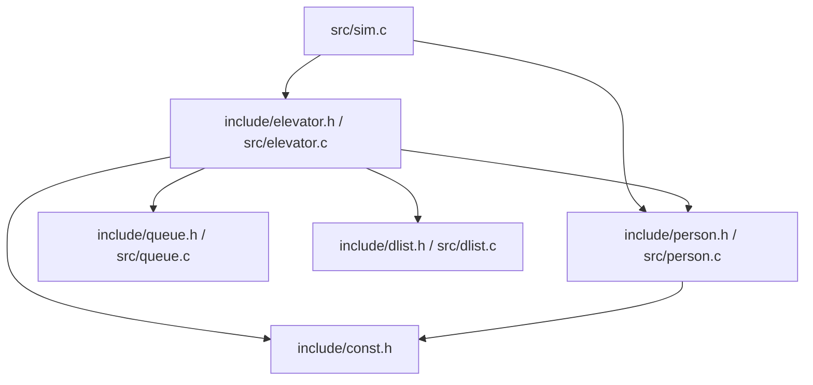

# 实现记录

只记已经谈定的实现。`rules_v1.md` 和 `thoughts.md` 不改。

语言用 C。代码由人自己写。某一段写完后，对照这一段补测试，用来自己跑、自己看结果。测试不代替讲解对错。

## 人

一个人一个结构体。全体按出现顺序放在一个数组里，下标就是记录里的编号。

出现时写入，之后不改的有：

- 出现时间
- 出现楼层
- 目标楼层
- 放弃时刻，等于出现时间加上最长等待
- 方向，由目标楼层和出现楼层比较得出，初始化时写一次

之后才写入的有：

- 状态

进门顺序不写在人身上。电梯里按进门顺序存的编号就是这个顺序。这是后面改的：原先准备在人身上记“第几个进入轿厢”。

状态五档：未出现、候梯、在轿厢、已到达、已放弃。

状态只在对应动作做完时改变。进门的 25t 还没走完，人仍是候梯。走完才改为在轿厢。出门的 25t 还没走完，人仍是在轿厢。走完才改为已到达。放弃只看仍是候梯、并且接他的那次到站还没发生的人。

查人不用哈希表。编号就是人数组的下标。

## 电梯的当前动作

电梯同一时刻只有一件正在做的事。记下种类、开始时刻、做完时刻。这件事若是某人进出，再记下是谁。

半途被打断时，已经花掉的时间等于当前时刻减去开始时刻。原来的做完时刻不留，改记一件新动作。

开门和关门是两种动作。关门走到 15t 被打断，就新开一件开门，时长也是 15t。

动作种类：

- 开门、关门
- 某人进门、某人出门
- 等 40t
- 加速 15t
- 向上走一层 51t、向下走一层 61t
- 上行临停 14t、下行临停 23t
- 空等 300t

走完一层才决定停不停。要停就再接一件临停，临停做完才开门。这一层不停，就直接开始下一层。半路新来的请求不改这一层已经在走的 51t 或 61t。楼层在“走一层”做完时改变，临停不改变楼层。

## 电梯还记住的事

当前楼层。

行驶状态四档：无方向、上行、下行、回程。回程不并进下行。回程半路有请求会取消这次回家；下行要走到折返层。

轿厢目的地：每一层有或没有。人进门按下楼层时点亮，决定在该层停下时灭掉。

轿厢里的人用双向链表。节点只存人的编号，另有前驱和后继。链表保存头指针、尾指针和人数。进门动作做完，新节点接到尾部。在某一层下车时，从尾部往头走，目标楼层是这一层的人摘下来，先摘到的先下车。不把人复制进节点。

这是后面改的：曾建议用数组存这些编号。数组够用，但这里改成双向链表，用来练习指针、头尾和人数。单向链表不做这次倒序删除。

## 候梯

每一层两个队列，分别是要上的和要下的。0 层没有向下的队列，4 层没有向上的队列。队列里只存人的编号。先出现的排在队头，后出现的从队尾进入。电梯只从正在服务的那一队的队头接人。

队列用单链表实现，有头指针和尾指针。对外只做出队和进队。不从队列中间删人。

人放弃时只把状态改成已放弃，节点留在队列里。接人时看队头：已经放弃就出队丢掉，再看下一个；还在候梯就让他进门。队列的操作仍然只有进队和出队。

最早的放弃时刻不靠队列来找。队列中间的人可能先到放弃时刻，而队头还在等。找放弃时刻时，看人数组里状态仍是候梯的人。

栈不用于轿厢，也不用于候梯。栈会不管目标楼层，把最后进来的人先弹出。

## 结构怎么拼

按钮用数组记亮或灭。0 层没有向下，4 层没有向上。

一层一个结构体，五层放在一个数组里。这个结构体里有：向上的队列、向下的队列、向上的按钮、向下的按钮。到站时，这一层的灯和队伍一起用。

电梯一个结构体。里面有：当前楼层、行驶状态、当前动作、轿厢目的地、轿厢双向链表。轿厢目的地属于电梯，不放进层的结构体。当前动作含种类、开始时刻、做完时刻；进出时再含人的编号。

人的数组、时钟、记录不放进电梯，也不放进层。它们是整次模拟的。

## 文件

层不单独成文件，放在电梯那一组里。层的灯和队伍只在电梯动作里一起用。

头文件在 `include/`，实现在 `src/`，测试在 `test/`，构建目录是 `build/`。

| 文件 | 负责 | 不负责 |
| --- | --- | --- |
| `include/const.h` | 楼层数、时间宏、方向和行驶状态这些共用枚举 | 任何动作 |
| `include/queue.h` `src/queue.c` | 单链表队列：初始化、销毁、进队、出队、是否为空、看队头 | 人的状态、放弃、灯 |
| `include/dlist.h` `src/dlist.c` | 双向链表：初始化、销毁、接到尾部、从尾往头走、摘掉一个节点、人数 | 谁该下车 |
| `include/person.h` `src/person.c` | 人的结构体、初始化、状态 | 移动电梯、改队列 |
| `include/elevator.h` `src/elevator.c` | 层、电梯、当前动作；点灯灭灯、接人放人、决定下一件动作 | 主循环、生成全部的人 |
| `src/sim.c` | 生成全部的人、时钟挑下一件事、调用电梯、写一行记录 | 链表节点怎么接 |

队列和双向链表不包含电梯规则。谁该进队、谁该从轿厢摘下来，由 `elevator.c` 判断，再调用进队、出队或摘节点。

依赖只向下。下层的文件不包含上层的头文件。

- `const.h` 在最底，不包含本项目的其他头文件。
- `queue` 和 `dlist` 是工具。节点里只放一个 `int` 编号。它们不包含 `person.h`，也不包含 `elevator.h`。不出现人的状态、楼层和灯。
- `person` 只认识人自己。不包含 `queue.h`、`dlist.h`、`elevator.h`。
- `elevator` 使用前三层。它调用进队、出队、接上、摘下，并改人的状态。
- `sim` 使用 `person` 和 `elevator`。它不直接改队列节点或链表节点。人出现时调用电梯提供的函数，由电梯决定进哪一队。

线从使用方指向它依赖的文件。同一排的文件互不包含。`queue`、`dlist`、`const.h` 是叶子，下面没有别的项目文件。

`queue` 和 `dlist` 互不包含。`person` 和它们也互不包含。

测试按文件另放，例如 `test_queue.c`，只包含 `queue.h`，不和 `sim.c` 混在一起。先写 `queue`。
